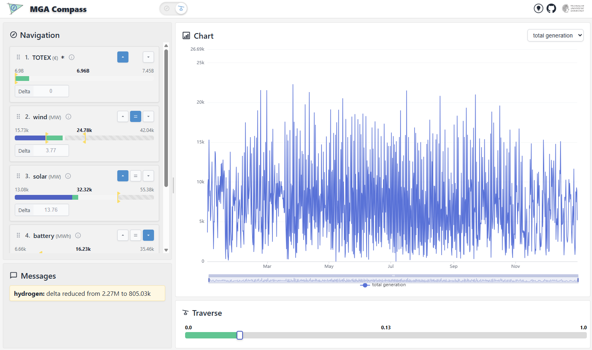

# MGA Compass


[](https://enormous-raphaela-eins-tu-darmstadt-215a3282.koyeb.app/)

**Presentation:** [eins-tuda.github.io/MGA-Compass](https://eins-tuda.github.io/MGA-Compass/)

Near-optimal solutions cost a small percentage more than the optimum. While slightly expensive, they can be preferable for political feasibility, social acceptance, or environmental impact.

This repository contains two parts:

| Part | What it does | Code |
|---|---|---|
| [**MGA Compass**](#mga-compass) | An interactive platform to explore the near-optimal solutions of an energy system model in real time. | [`app/`](app) (web backend and frontend), [`mga-compass/`](mga-compass) (navigation, interpolation and plotting library) |
| [**MGA Surveyor**](#mga-surveyor) | The implementation of the G-ORACLE method for [PyPSA](https://pypsa.org): computes the near-optimal space of a PyPSA model, with a guaranteed bound on how much of it is still unexplored. | [`mga-surveyor/`](mga-surveyor) (Python package `mga_surveyor`) |

MGA Surveyor finds the near-optimal solutions; MGA Compass lets you explore them. The two libraries are independent, and the platform can serve points from any source; the dataset scripts in [`mga-compass/scripts`](mga-compass/scripts) use MGA Surveyor to generate the platform's data.

<a id="mga-compass"></a>

##  MGA Compass

**Live demo:** [enormous-raphaela-eins-tu-darmstadt-215a3282.koyeb.app](https://enormous-raphaela-eins-tu-darmstadt-215a3282.koyeb.app/)

The demo shows the solutions of [PyPSA-Eur](https://github.com/PyPSA/pypsa-eur) within 5% of the optimal cost: electricity only, one node per country (34 nodes), one year at 3-hourly resolution.



<a id="mga-surveyor"></a>

##  MGA Surveyor

MGA Surveyor is the implementation of **G-ORACLE** for [PyPSA](https://pypsa.org) models. G-ORACLE is an MGA method that explores the near-optimal solutions of an energy system model with a guaranteed convergence tolerance. It refines an inner and an outer polytope approximation of the near-optimal space until they are within the tolerance, finding each new trial point by vertex enumeration of the outer approximation.

<p align="center"></p>

## Citation

If you use **MGA Compass**, please cite:

S. Hajikazemi and F. Steinke, "Interactive Exploration of Near-Optimal Solutions of Energy Planning Models," in *2026 22nd International Conference on the European Energy Market (EEM)*, 2026, pp. 1–6. [doi:10.1109/EEM68581.2026.11589682](https://doi.org/10.1109/EEM68581.2026.11589682)

```bibtex
@inproceedings{hajikazemi2026compass,
  title     = {Interactive Exploration of Near-Optimal Solutions of Energy Planning Models},
  author    = {Hajikazemi, Sina and Steinke, Florian},
  booktitle = {2026 22nd International Conference on the European Energy Market (EEM)},
  year      = {2026},
  pages     = {1--6},
  doi       = {10.1109/EEM68581.2026.11589682}
}
```

If you use **MGA Surveyor** or G-ORACLE, please cite:

S. Hajikazemi and F. Steinke, "G-ORACLE: A Fast Geometric Method To Explore All Near-Optimal Designs for Energy Systems," arXiv:2610.32759, 2026. [arxiv.org/abs/2610.32759](https://arxiv.org/abs/2610.32759)

```bibtex
@misc{hajikazemi2026goracle,
  title         = {G-ORACLE: A Fast Geometric Method To Explore All Near-Optimal Designs for Energy Systems},
  author        = {Hajikazemi, Sina and Steinke, Florian},
  year          = {2026},
  eprint        = {2610.32759},
  archivePrefix = {arXiv},
  primaryClass  = {math.OC},
  url           = {https://arxiv.org/abs/2610.32759}
}
```
