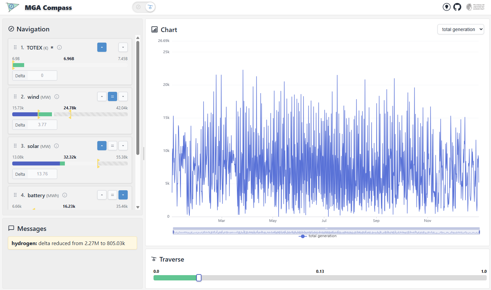

# MGA Compass

MGA Compass is an interactive platform for exploring the near-optimal solutions of an energy
system model in real time. You start from a solution, say how the next one should differ in
a few properties you care about, and the platform finds it and shows the transition along an
approximately cost-optimal path.

It consists of a web application (`app/`: backend and frontend) and the `mga-compass` Python
library, which holds the navigation, interpolation and plotting logic the platform runs on.
The library has no GUI or server dependencies.

**Live demo:**
[enormous-raphaela-eins-tu-darmstadt-215a3282.koyeb.app](https://enormous-raphaela-eins-tu-darmstadt-215a3282.koyeb.app/)

The demo shows the solutions of [PyPSA-Eur](https://github.com/PyPSA/pypsa-eur) within 5% of
the optimal cost: electricity only, one node per country (34 nodes), one year at 3-hourly
resolution.



- **[Getting started](../getting-started.md):** a first run, start to finish.
- **[Explanation](explanation.md):** how the approach works and why.
- **[How-to guides](how-to.md):** instructions for specific tasks.
- **[Reference](../reference/index.md):** the dataset format, the server settings, the
  dataset scripts and the API.

```{toctree}
:hidden:

explanation
how-to
```
